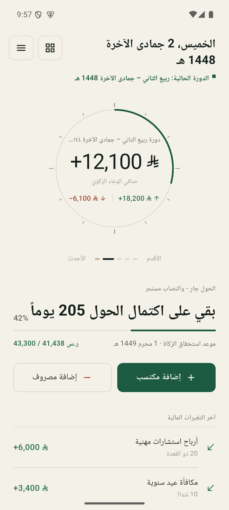
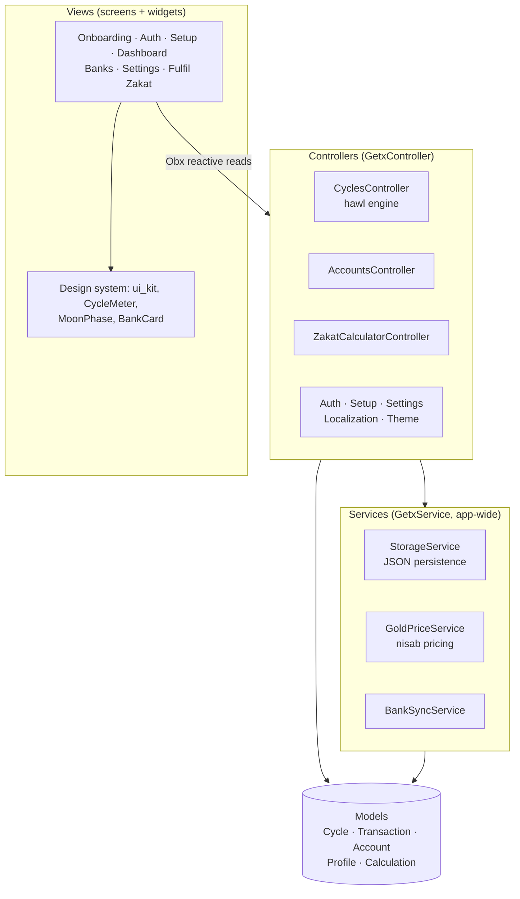
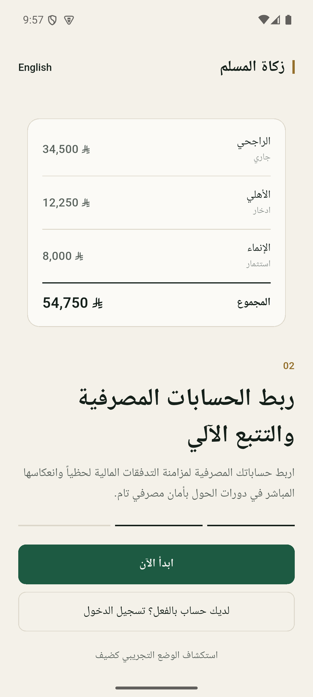
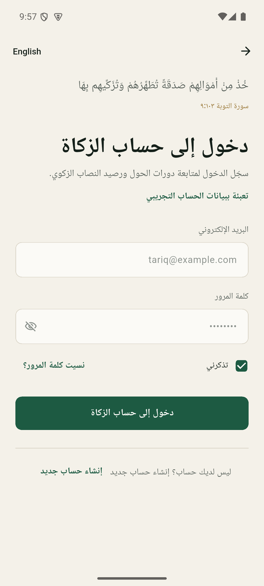
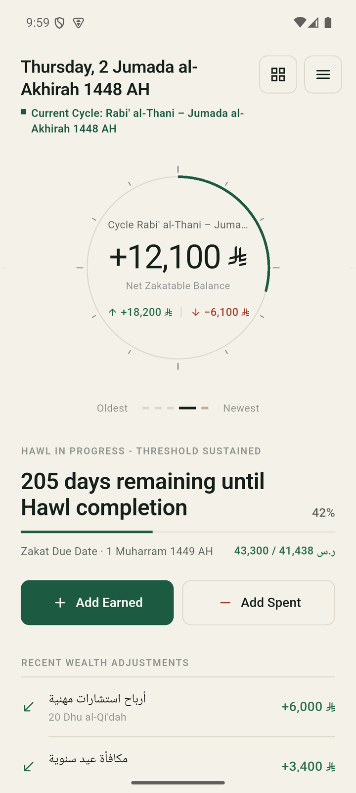

# زكاة المسلم · Muslim Zakat

An Arabic-first Flutter app that tracks zakat the way Islamic law counts it: by the lunar Hijri year. Income and spending flow into short Hijri cycles, a rolling one-year window checks them against the gold nisab, and the app tells you when zakat is due and how much.

I designed and built it end to end: the zakat rules engine, the state and data layers, a custom design system, and the custom-painted widgets.

**[Download the APK →](../../releases/latest)** · Flutter 3.44 · Dart 3 · GetX · Android

<p>
  
  
  
</p>

---

## Highlights

- **A real rules engine, not a calculator.** Zakat is only due when wealth stays above the nisab for a full lunar year. The app models this as a rolling window of Hijri cycles with automatic locking and evaluation, and rollover of balances below the nisab (explained [below](#the-hawl-engine)).
- **Hijri-native date handling.** Every cycle boundary, due date and label is computed in the Umm al-Qura calendar, with a user setting to shift the calendar by a day to match local moon sighting.
- **Custom painting.** The hawl dial, the 12-tick progress gauge and an astronomically correct moon-phase renderer are drawn with `CustomPainter`.
- **Full Arabic and English**, with right-to-left layout, about 540 translated strings per language, and fonts chosen per script.
- **An in-house design system** with color, type and spacing tokens, shared components, and matching light and dark themes.
- **48 automated tests** covering the zakat engine, cycle rollover, authentication, setup and the main screens.

---

## Tech stack

| Area | Choice | Why |
|---|---|---|
| UI | Flutter 3.44, Material 3 | One codebase, full control over rendering for custom widgets |
| Language | Dart 3 (records, pattern matching) | Concise, type-safe models |
| State and DI | GetX (`GetxController`, `Obx`, `Bindings`, `GetxService`) | Reactive state, per-route dependency injection and routing in one small package |
| Persistence | `shared_preferences`, with models serialized to JSON | Offline-first, with no backend required for the demo |
| Calendar | `hijri` + `intl` | Umm al-Qura conversions and localized date formatting |
| Localization | GetX `Translations`, `ar_SA` and `en_US` | Runtime language switching without restarting the app |
| Typography | `google_fonts`: Amiri, Newsreader, IBM Plex Sans Arabic, IBM Plex Sans | Proper Arabic shaping, plus tabular figures for money |
| Graphics | `CustomPainter`, `flutter_svg` | Dials, the moon renderer, and the new Saudi Riyal symbol as a vector |
| Quality | `flutter_test`, `flutter_lints` | Unit and widget tests, plus a linted codebase |

---

## Architecture

The app is organized in layers. Views stay thin, controllers own state and rules, and services own I/O.



```
lib/
├── main.dart                 # bootstraps services, theme, locale, routes
├── core/
│   ├── theme/                # color tokens, type scale, light/dark ThemeData
│   ├── translations/         # ar_SA + en_US string tables
│   └── utils/                # routes + bindings, Hijri date helper, zakat rules, moon math
├── models/                   # immutable data classes with toJson/fromJson
├── services/                 # storage, gold price, bank sync
├── controllers/              # state and business rules, one per feature
└── views/
    ├── screens/              # one file per screen
    └── widgets/              # shared design-system components
```

**Main decisions:**
- **Dependency injection per route.** Each route declares a `BindingsBuilder`, so its controllers are created when the screen opens and disposed when it closes. App-wide services are registered once in `main()`.
- **Rules live in controllers, never in widgets.** The hawl engine in `CyclesController` can be tested without rendering anything, and the dashboard only reads reactive state.
- **Models serialize themselves.** Each model has `toJson` and `fromJson`. `StorageService` is the only class that touches disk, so replacing it with a remote API would be a change in one place.
- **Strings are keys, not literals.** Text goes through `AppStrings` constants and `.tr`, so a missing translation is easy to spot.

---

## The hawl engine

Zakat is 2.5% of wealth that has stayed at or above the **nisab** (the value of 85 g of gold) for a full **hawl** (one lunar year). Real income doesn't arrive once a year, so the app splits the Hijri year into cycles and evaluates a sliding window:

1. **Cycles.** The user picks a cycle length of 2, 3, 4 or 6 Hijri months, so a hawl is 6, 4, 3 or 2 cycles. Each cycle tracks `earned`, `spent` and `pouredIn`, with `net = earned − spent + pouredIn`.
2. **Locking.** When a cycle's period ends, it locks and waits inside the window.
3. **Evaluation.** When the oldest cycle in the window is a full lunar year old, the engine adds up the window and compares it to the nisab.
4. **Below the nisab:** no zakat is due. The app offers to **pour the oldest cycle's balance into the next one** with one tap, then archives the oldest cycle and slides the window forward. Money below the nisab is never taxed, and none of it is lost.
5. **At or above the nisab:** the window is marked zakat due. The amount is 2.5% of the window total, and the user is led to a payment statement. Once zakat is recorded as paid, the same money is never charged again.

Cycle status (active, locked, upcoming) comes from the calendar and is never stored, so it can't drift out of date. Evaluation reruns whenever data loads or changes. Every rollover and payment writes an audit transaction, so the user can always trace where a balance came from. Changing the cycle length re-splits history without losing any balance.

---

## Design system

I built a small design system called **Ledger** for the app. It avoids generic, template-looking UI:

- **Palette:** warm paper and ink tones, one deep green accent, and brass reserved for zakat-due moments. No gradients, glows or colored shadows.
- **Typography:** Amiri and Newsreader for display text, IBM Plex Sans (Arabic and Latin) for the interface, and tabular figures so amounts line up in columns.
- **Structure:** hairline dividers instead of shadowed cards inside cards, and a consistent 10 px control radius and 16 px sheet radius.
- **Components** in `ui_kit.dart`: `Amount`, `CurrencyMark`, `Sheet`, `LabeledField`, `PrimaryAction`, `StatusTag`, `Segment`, `showLedgerSheet()`, and more.
- **Moon phases** are computed from the mean synodic month (29.53 days) and drawn with the correct terminator shape, limb shading, the main lunar "seas" and earthshine. The math is checked against real new and full moon dates.

---

## Screens

| Onboarding | | |
|---|---|---|
|  |  |  |
| Tonight's real moon phase and the current Hijri month | Accounts brought into one ledger | The rate: one fortieth |

| App | | |
|---|---|---|
|  |  |  |
| Sign in | Connected banks | Settings: nisab standard, cycle length, metal prices, Hijri adjustment |

| Themes and languages | |
|---|---|
|  |  |
| Dark mode | English, left-to-right |

---

## Testing

There are 48 tests across 7 suites, all run with `flutter test`:

| Suite | Covers |
|---|---|
| `zakat_engine_fixes_test` | Currency-aware gold nisab, no double charging after payment, a window limited to one year, rollover that never loses balance, and keeping balances when the cycle length changes |
| `cycle_hawl_test` | Cycle counters, a full sub-nisab rollover scenario, and cycle status derived from calendar dates |
| `dashboard_cycles_test` | The cycle window shown on the dashboard, grid/carousel preference, the zakat-due flow to payment, and the rollover flow |
| `widget_test` | Translation coverage in both languages, model serialization, the 2.5% calculation, Hijri conversions, theme fonts, and demo data seeding |
| `auth_and_setup_flow_test` | Onboarding, login, sign-up, and the 4-step setup wizard |
| `connected_banks_test` | The bank card widget, and adding, editing, syncing and deleting accounts |
| `dashboard_drawer_test` | Navigation drawer and routing to the banks screen |

---

## Status and roadmap

This is a working demo. To be clear about what is real and what is simulated:

- ✅ The hawl engine, cycles, rollover, Hijri dates, localization, themes and local persistence are complete.
- 🔶 **Bank sync is simulated** with sample institutions. The next step is an open-banking integration; Saudi Arabia's SAMA open-banking framework is the target.
- 🔶 **Gold and silver prices** use reference values that the user can override. The next step is a live metals and exchange-rate feed.
- 🔜 Cloud sync and backup, and a signed Play Store release.

---

## Try it

1. Download `muslim-zakat-v1.0.0.apk` from the [latest release](../../releases/latest).
2. Open it on an Android phone (Android 7.0 or newer) and allow installs from your browser or file manager when asked.
3. Tap **استكشاف الوضع التجريبي كضيف** (Explore demo as guest) to try it with sample data.

The source code is private. I'm happy to walk through it in an interview or share access on request.

---

**Fares Slimani** · Flutter developer · [GitHub](https://github.com/MFaresSlimani)
