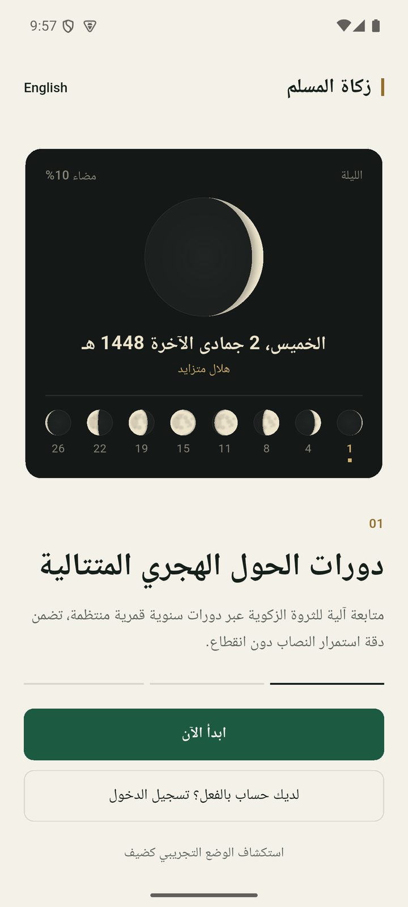
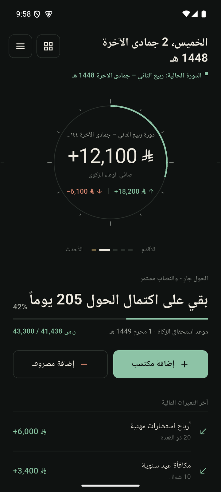
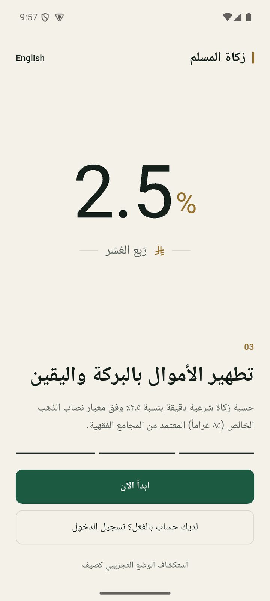
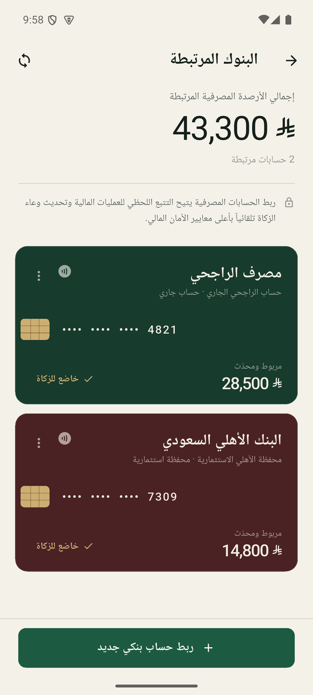
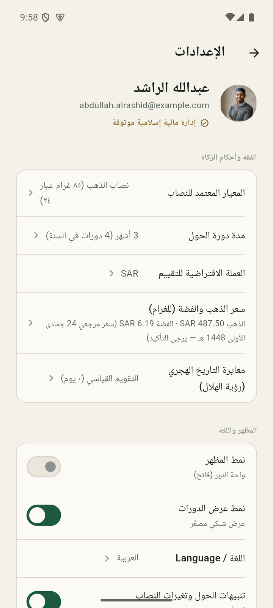

# زكاة المسلم · Muslim Zakat

An Arabic-first Android app for tracking zakat across the Hijri year. It follows your hawl cycle by the lunar calendar, brings bank balances into one ledger, and works out zakat at the 2.5% rate against the gold nisab.

**[Download the latest APK →](../../releases/latest)**

  
  
  

## Screens

| Onboarding | | |
|---|---|---|
|  |  |  |
| Tonight's real moon phase and the shape of the current Hijri month | Accounts brought into one ledger | The rate: one fortieth |

| App | | |
|---|---|---|
|  |  |  |
| Sign in | Connected banks | Settings: nisab standard, hawl length, gold and silver prices |

| Themes and languages | |
|---|---|
|  |  |
| Dark mode | English |

## Features

- **Hawl tracking by the Hijri calendar.** Shows how many days remain until the year completes and when zakat falls due.
- **Real moon phases.** The onboarding shows tonight's moon and the month's phases, calculated from the date.
- **Nisab check.** Compares your zakatable balance against the gold nisab (85 g of 24k gold).
- **Connected accounts.** Bank balances and income or spending adjustments feed the cycle.
- **Arabic and English**, with right-to-left layout, plus light and dark themes.

## Install

1. Download `muslim-zakat-v1.0.0.apk` from the [latest release](../../releases/latest).
2. Open it on your Android phone and allow installs from your browser or file manager when asked.

This is a demo build: tap **استكشاف الوضع التجريبي كضيف** (Explore demo as guest) to try it with sample data. It needs Android 7.0 or newer.

---

The source code is private. This repository holds the screenshots and release builds only.
